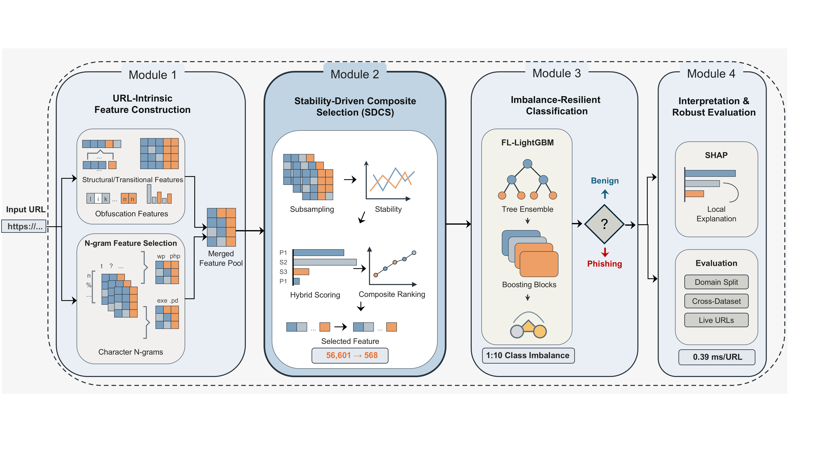

# LitePhish

Code, datasets, trained inference components, and evaluation records for **LitePhish: Resource-Efficient URL-Intrinsic Phishing Detection for Consumer Electronics**.

LitePhish combines 86 URL-intrinsic descriptors with selected character 2-/3-grams. Stability-Driven Composite Selection (SDCS) controls feature relevance, recurrence, and redundancy. A focal-loss-inspired LightGBM classifier supports phishing detection without synthetic resampling. The evaluation includes domain-disjoint partitions, four source–target transfers, probability calibration, distribution shift, PhreshPhish external evaluation, and physical ARM smartphone measurements.



## Installation

```bash
git clone https://github.com/aI-area/PhishDetecting.git
cd PhishDetecting
python -m venv .venv
# Activate .venv using the command for your operating system.
pip install -r requirements.txt
```

The reference classical-model environment uses Python 3.9.20, NumPy 2.0.2, pandas 2.2.3, scikit-learn 1.6.1, SciPy 1.13.1, and LightGBM 4.5.0. Neural baselines and URLNet need separate compatible environments; see [experiments](experiments/README.md).

## Datasets

The four core evaluation datasets use `url` and `phishing` columns (`1` = phishing).

| Dataset | Benign | Phishing | Total |
|---|---:|---:|---:|
| PhishFusion | 52,995 | 52,757 | 105,752 |
| Ebbu2017 | 36,400 | 37,175 | 73,575 |
| PhishStorm | 48,009 | 47,902 | 95,911 |
| PhishTank, external evaluation | 51,453 | 42,335 | 93,788 |
| PhreshPhish, external evaluation | 89,686 | 76,541 | 166,227 |

Files are in [`dataset`](dataset). PhishTank contains **93,788 URLs** for external evaluation. Phone resource measurements use a fixed **5,000-URL workload** (2,705 benign and 2,295 phishing URLs), retained with the inference bundles. See [the dataset notes](dataset/README.md).

The additional [PhreshPhish evaluation](dataset/PhreshPhish/README.md) uses a pinned
public test release of 168,060 URLs. Source-overlap and eligibility controls retain
166,227 URLs (89,686 benign; 76,541 phishing); the source-domain-disjoint subset
contains 141,623 URLs. It is separate from the PhishTank cohort. Full URL metadata,
eligibility definitions and all comparative results are provided.

`merged.csv` is the exact URL/label union of PhishFusion, Ebbu2017, and PhishStorm for descriptive keyword analysis only: 125,510 phishing and 130,899 benign URLs. It is not an additional training or test cohort.

## Training and inference

Use your own dataset locations, for example:

```bash
python main.py --dataset your_path/PhishFusion.csv
python test.py your_path/Phishtank/PhishTank.csv --artifacts artifacts/litephish --output local_results/PhishTank_predictions.csv
```

The saved components in `artifacts/litephish` correspond to the 568-feature PhishFusion representation used in the objective and resource studies. Pickle/joblib files must only be loaded from a trusted source. Feature counts are source- and protocol-dependent, not universal constants. Training a new model does not automatically reproduce a frozen result unless the dataset bytes, row assignments, parameters, and environment also match.

The canonical PhishFusion partition is [`manifests/PhishFusion.csv`](manifests/PhishFusion.csv): 86,098 training, 8,278 validation, and 11,376 test rows. Its per-row URL hashes bind the assignments to the released source order. Newly generated split manifests are separate partitions unless their row assignments match this manifest.

## Experiments and results

| Main display | Analysis | Public entry points / records |
|---|---|---|
| Table II | Dataset composition | `dataset/`, `results/dataset_composition.csv`, `results/union_flow.csv` |
| Table III | Internal comparisons, including Roy et al. | Shared-split runners; `run_roy_baseline.py`; `results/roy_phishfusion_predictions.csv` |
| Table IV / Figure 3 | Four transfers | Cross-dataset runners; `results/cross_dataset_roc_points.csv.gz` |
| Table V | Matched-budget selectors | `compare_feature_selectors.py`; `results/selector_*.csv` |
| Table VI | Paired focal-objective comparison | `run_focal_imbalance_ablation.py`, `compare_probability_objectives.py`; `results/objective_*` |
| Table VII(a) | External PhishTank evaluation | Prediction evaluators; `results/roy_external_predictions.csv` |
| Table VII(b) | External PhreshPhish comparison | `experiments/phreshphish/`; `results/phreshphish/` |
| Table VIII | Physical smartphone quality and resources | `experiments/android/`; `results/phone_*.csv` |
| Table IX | Source-only distribution-shift alternatives | `fit_shift_representations.py`, `evaluate_shift_conditions.py`; `results/distribution_shift_summary.csv` |
| Figure 5 | Detection–resource frontiers | `summarize_phone_tradeoffs.py`; `results/pareto_*.csv` |
| Table X | Paired raw/compact representations | Compactness runners; `results/compactness_resources.csv` |

See the [workflow guide](experiments/README.md), [configuration](experiments/LITEPHISH_CONFIGURATION.md), and [results map](experiments/RESULTS_REPRODUCTION_MAP.md) for exact scopes and commands. A lightweight independent check of the retained CSV/NPZ records is available with:

```bash
python -m experiments.validate_public_results --root .
```


The [SDCS component study](experiments/SDCS_COMPONENTS.md) retains all four
conditions across ten seeds in `results/sdcs_components`. Source-validation
low-FPR analyses are in `results/low_fpr`; these retain every objective, seed and
operating point. Check the complete external and supporting result records with:

```bash
python -m experiments.validate_extended_results --root .
```
